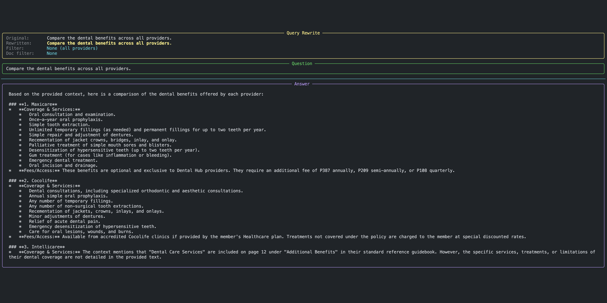
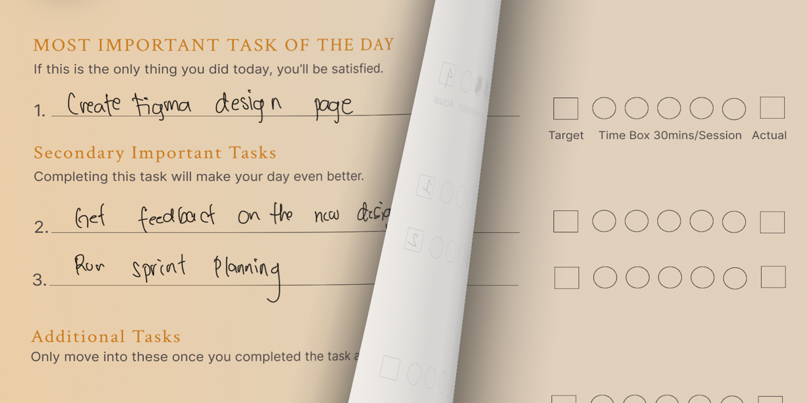
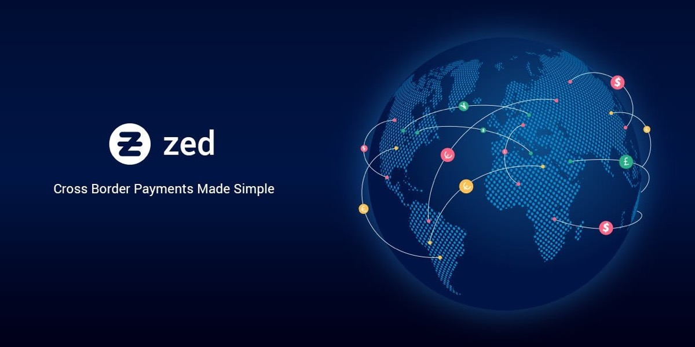
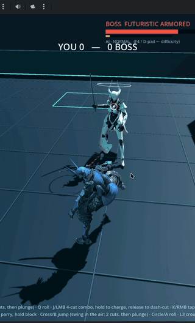
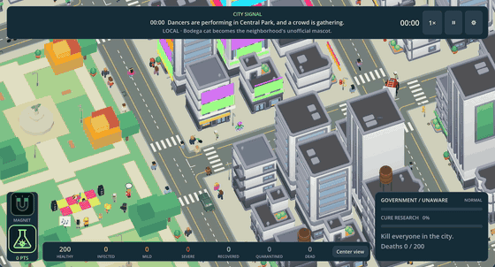

<!-- ===================== HEADER ===================== -->
<h1 align="center">Hi, I'm Orville 👋</h1>
<h3 align="center"> Polymath · Senior Software Engineer · AI-Native Builder</h3>

  Currently building <b>AI Accounting</b> at <a href="https://manuci.com">Manuci.com</a> 🇵🇭 
  9+ years shipping full-stack products, 4+ years leading engineering teams.

  
  
  

# Project Showcase

<!-- ===================== TECH STACK ===================== -->

<!-- ===================== PROJECTS ===================== -->
<table>
  <!-- ---------- Row 1 ---------- -->
  <tr>
    <!-- Healthcare RAG -->
    <td width="50%" valign="top">
      
      <h3>🩺 Healthcare RAG Assistant</h3>
      

        A retrieval-augmented generation system that helps healthcare providers search plan and benefits documents.
        I built it to put ideas from Chip Huyen's <i>AI Engineering</i> into practice.
      

      <ul>
        <li>Layered retrieval that combines metadata filters by provider with exact-match text filters for medical terms</li>
        <li>Restructured chunking, with a heading and summary for each chunk, which noticeably improved retrieval quality</li>
        <li>Re-ranking and evaluation loops to close the gap between how users ask questions and how documents are written</li>
      </ul>
      

        
        
        
      

      <a href="https://github.com/orvillelim/Healthcare-RAG"><b>View repo →</b></a>
    </td>
    <!-- Oasis Journal -->
    <td width="50%" valign="top">
      
      <h3>📓 Oasis Journal (iPad)</h3>
      

        My first iOS app. It's a digital journal for iPad, inspired by my own pen-and-paper journaling habit.
        Hobonichi-inspired designs are on the roadmap.
      

      <ul>
        <li>Published on the App Store</li>
        <li>Designed for iPad with Apple Pencil–friendly journaling</li>
      </ul>
      

        
        
      

      <a href="https://apps.apple.com/app/YOUR_APP_ID"><b>View on the App Store →</b></a>
    </td>
  </tr>
  <!-- ---------- Row 2 ---------- -->
  <tr>
    <!-- B2B Payment API -->
    <td width="50%" valign="top">
      
      <h3>💳 B2B Payment API & Web App</h3>
      

        A payment REST API service and a payment web app, built and launched in 3 months at ZED Network.
        It generated about <b>$30k/month</b> in revenue for a B2B client.
      

      

        
        
        
        
        
        
        
      

    </td>
    <!-- TLS Article -->
    <td width="50%" valign="top">
      
      <h3>✍️ Learn to Create a Free TLS Certificate in 5 Minutes</h3>
      
My first technical article: a quick, practical guide to setting up free TLS certificates.

      <a href="https://medium.com/@orville.lim95"><b>Read on Medium →</b></a>
    </td>
  </tr>
</table>

# Game DEV

<!-- ===================== INDIE GAMES ===================== -->
<table>
  <tr>
    <!-- Ninja Warrior -->
    <td width="40%" valign="top" align="center">
      
    </td>
    <td width="60%" valign="top">
      <h3>🥷 Ninja Warrior (Demo)</h3>
      

        A 3D melee action game where you duel an armored boss in a futuristic arena.
      

      <ul>
        <li>4-hit sword combos, plus a charged dash-cut</li>
        <li>Rolls, parries and blocks for defense</li>
        <li>Jump attacks: 2 cuts in the air, then a plunge</li>
        <li>Boss AI with adjustable difficulty</li>
        <li>Plays with keyboard and mouse or a controller</li>
      </ul>
    </td>
  </tr>
</table>
<!-- Outbreak: City Zero -->
<table>
  <tr>
    <td width="60%" valign="top" align="center">
      
    </td>
    <td width="40%" valign="top">
      <h3>🦠 Outbreak: City Zero (Demo)</h3>
      

        A city outbreak sim where you play as the infection, spreading through a city of 200 people while the government researches a cure.
      

      <ul>
        <li>Pick anyone in the city, then infect or follow them</li>
        <li>Each person has symptoms, sickness and a stress score</li>
        <li>A live "City Signal" news feed of events like crowds, politics and weather</li>
        <li>Tracks government awareness and cure progress</li>
      </ul>
    </td>
  </tr>
</table>
